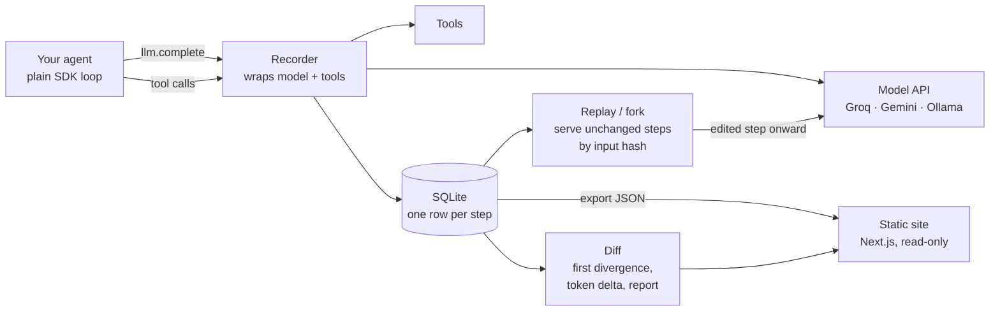

# Retrace

**A time-travel debugger for AI agents: record every step of a plain SDK agent loop, replay it for free, fork it at any step with an edit, and diff two runs to find the first step where they split.**

**Live demo:** _coming soon_ (read-only viewer of saved runs, diffs and results)

## Results

Small mutation experiment: 10 seeded bugs in the demo agent, 2 for each of 5 bug types, one trial each. Full table and method in [RESULTS.md](RESULTS.md); raw data in [`results/`](results).

| Experiment | Raw JSON logs | Retrace |
| --- | --- | --- |
| A. Diff's first divergence is the mutated step | – | **10 of 10** |
| B. Model names the right step and bug type | 8 of 10 | 8 of 10 |
| B. Model names the right step | 9 of 10 | 10 of 10 |

The PRD target for B (the diff report right at least twice as often as raw logs) was **not met**. The demo runs are short, so the raw logs are easy to read whole. A is easy by construction: steps before each bug come from the cache and are identical. See [Limitations](#limitations).

## How it works



- **Record (R1, R2):** `record(tools)` wraps `llm.complete` and your tool functions. Each step's type, name, input, output, tokens and latency go to SQLite. `export_run` turns a run into JSON.
- **Replay (R3):** a step is "unchanged" if the sha256 of its type, name and input matches a recorded step. Replay serves the recorded output and calls nothing, so it costs zero tokens. A call that matches nothing raises `ReplayDivergence`.
- **Fork (R4):** replays up to step N, applies your edit at step N (a tool result, a message or the system prompt), then runs live from there.
- **Side effects (R5):** tools marked `side_effecting = True` never run during replay, and a fork never repeats a call the original run already made.
- **Diff (R7):** the first step where two runs differ, the exact paths that changed, the steps after the split, and the token and cost delta, as JSON plus a short text report.

## Quickstart

Needs Python 3.11+ and a free [Groq](https://console.groq.com) or [Gemini](https://aistudio.google.com) key, or a local [Ollama](https://ollama.com).

```bash
python -m venv .venv
.venv/Scripts/python -m pip install -e ".[dev]"   # on macOS/Linux: .venv/bin/python
cp .env.example .env                              # then add GROQ_API_KEY and/or GEMINI_API_KEY
.venv/Scripts/python -m pytest -q                 # tests use a fake model, no keys needed
```

Record, fork and diff the demo agent:

```python
from retrace import llm
from retrace.recorder import record
from retrace.replay import fork
from retrace.diff import diff, diff_report
from examples.research_agent.agent import TOOLS, run

llm.load_env()
question = "How much more does a Cargo Lite cost than a Commuter?"
with record(TOOLS) as original:              # the two lines that record a run
    run(question)
with fork(original, step=3, edit=lambda output: "1000", tools=TOOLS) as forked:
    run(question)                            # steps 0-2 replayed free, calculator result edited, rest live
print(diff_report(diff(original, forked)))
```

Re-run the experiment (resumes from `results/` and stops cleanly at the daily quota), export the site data, and run the site:

```bash
.venv/Scripts/python -m experiments.mutation_experiment
.venv/Scripts/python scripts/export_site_data.py
cd site && npm install && npm run dev
```

## Limitations

- **Small experiment:** 10 mutations, one trial each, one analyst model and one prompt. The numbers are indicative only.
- **Short demo runs:** they're 3–8 steps, so this doesn't test the long-run case where raw logs become unreadable.
- **The cache does a lot of the work:** prefixes match because llm.py caches every model call by its input. A live model at temperature 0 can still vary between runs, which would add divergences unrelated to the bug.
- **Model calls must go through `llm.complete`:** recording patches that module attribute. Code that imports `complete` directly isn't recorded.
- **Unstable inputs break replay:** if an agent puts something that changes every run into a model input (a timestamp, a random ID), replay diverges. There's no option yet to leave fields out of the hash.
- **Replayed errors are stand-ins:** they keep the original name and message, but they're a stand-in class, so `except ZeroDivisionError` won't catch them.
- **Not built yet:** R6 (local live UI with edit-and-fork panel) and R8 (export a failing step as a test). The PRD's 50-run replay-fidelity measurement isn't done; the test suite checks 10 runs byte-identical.
- **No real costs:** the free tiers cost $0, so the cost delta is always $0. Set prices in `retrace/config.py` for a paid tier.

## Project layout

```
retrace/            llm.py (cached model client), recorder.py, replay.py, diff.py, config.py
examples/           research_agent: search_docs, calculator, save_note over 20 fictional documents
experiments/        mutation_experiment.py
results/            experiment runs, diffs, scores (source of RESULTS.md)
site/               Next.js static viewer; reads only site/public/data
tests/              pytest, fake model client
```
